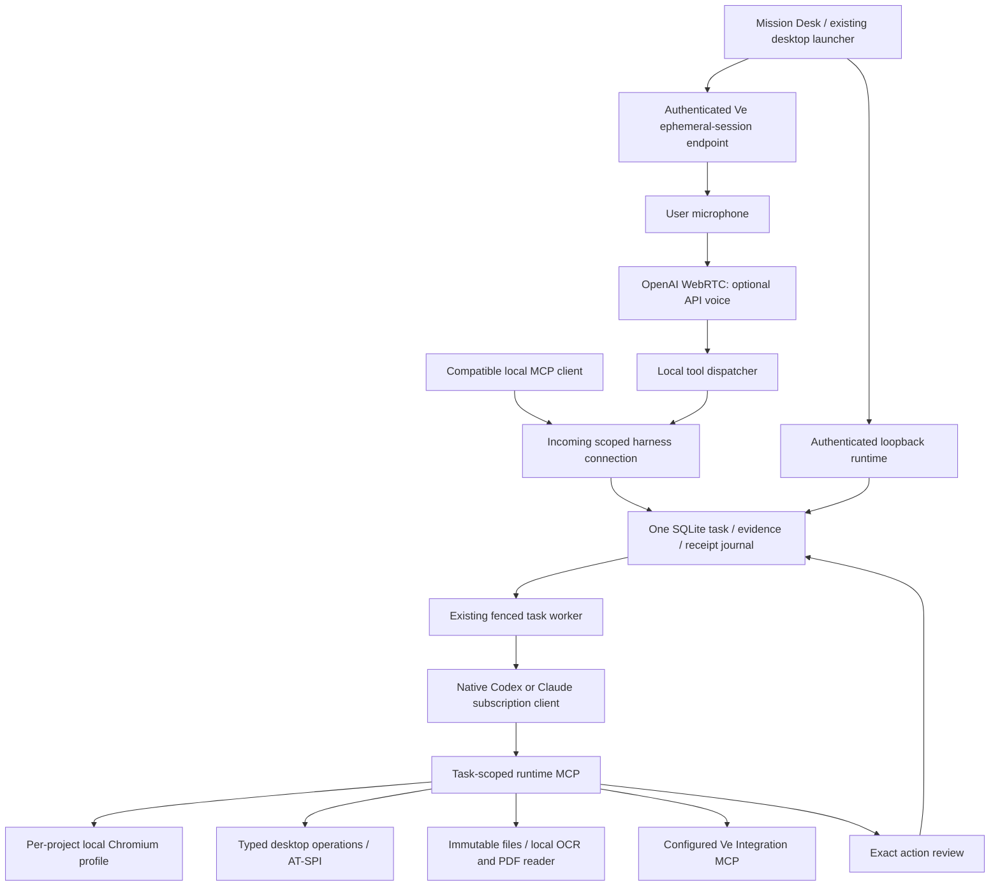

# VeOS application controls and voice delegation

Implementation date: 20 November 2026. Repository: `veailabs/Ve_Os`. Base runtime: `ve/feat/mission-runtime` at `1f62bb19f95e69309c77f8a4a0e3a4d3d8409f9a`, draft PR #2. At the start of this work, remote `master` was `b6440cfbd0d5806b7e4a361046148e4e600dcf29` and did not include that runtime. These additions are a separate change on top of #2; a source checkout is not a deployed OS.

## Architecture



The desktop adapters run at the user-session/application interface layer. They do not run an agent in the kernel or install a privileged service. Hyprland manages windows, AT-SPI exposes supported application controls, Playwright controls the project browser and Omarchy's existing commands/settings customize the desktop. The single local worker remains responsible for admission, run limits, continuation, cancellation and recovery.

## Operation contract

The agent first calls `available_tools`, which includes operation availability, argument descriptions, per-project grants and settings categories. The general `desktop` tool receives `{operation, args, request_key?}`. It dispatches typed arguments to fixed executable argument arrays; it never interpolates an agent-supplied command into a shell.

| Area | Read/discovery | Reviewed action |
|---|---|---|
| Applications/windows | `apps`, `windows`, `displays` | `open_app(app_id)`, `focus_window(address)` |
| Native controls | `native_read(app_pid, offset?)` | `native_action(app_pid,node,revision,action)`, `native_fill(app_pid,node,revision,text)` |
| Appearance | `themes`, `fonts` | `set_theme(name)`, `set_font(name)`, `configure(area,values)` |
| Existing settings | Discovered category list | `open_settings(area)`; users may open it directly from Mission Desk |
| Audio | `audio(device?)` | `set_audio(device?,volume?,muted?)` |
| Clipboard | `clipboard_read` | `clipboard_write(text)` |
| Capture/files | `read_document(artifact_id,offset?)` | `screenshot` |

Configuration fields currently supported directly: appearance `gaps_in`, `gaps_out`, `border_size`, `rounding`; input `sensitivity`, `natural_scroll`, `tap_to_click`. Other customizations open the existing Omarchy settings/editor. No arbitrary package installation, arbitrary Lua, arbitrary screen coordinates or unrestricted OS command is exposed through this tool.

Generated overrides target the current Lua option names, including `input.touchpad.tap_to_click`, following the [Hyprland configuration contract](https://github.com/hyprwm/hyprland-wiki/blob/main/content/configuring/core/config-options.md).

The settings panel exposes branding, themes/backgrounds, fonts/icons, bar/dock, window/layout settings, keyboard/input, default apps, plugins, native agent selection, networking, monitor configuration, startup and notifications. OS agent selection is Omarchy's native setting; it does not add a new executable adapter to the Mission Desk worker. Codex and Claude remain the worker's qualified adapter implementations; Hermes is not silently mapped to either.

The native adapter refuses browser/terminal processes, web-document trees and Mission Desk administration. It cannot be used to bypass project browser grants or operate its own action-review page. An incomplete native tree cannot be used to propose a mutation. Applications with embedded web interfaces may therefore need a supported browser/API integration instead.

## Browser improvements

The semantic reader handles named controls, `aria-labelledby`, non-sensitive field values, checkbox/select state, rich editors, open shadow roots, granted frames and tabs. `read` accepts `query`, `control_offset`, `control_limit`, `text_offset`, `text_limit` and `frame_id`. Follow returned continuation offsets; preserve the selection arguments in subsequent action proposals. Closed shadow roots, inaccessible frames and browser/OS dialogs outside the supported JavaScript dialogs remain limitations.

Each change is bound to the tab/frame and observed actionable state, including form text. Unrelated body clock text no longer invalidates an action; meaningful control/form edits do. This is a targeted consistency check, not an atomic transaction with a remote site. Stale revisions fail before input delivery and allow a fresh reviewed proposal; uncertain delivered actions cannot silently replay. Stable request keys identify retries, while intentional repeats need new keys.

Explicit operations cover checkbox state, select values, empty or whitespace-preserving edits, scrolling to observed controls, drag/drop, file upload/download and dialog acceptance/dismissal. JavaScript confirmation dialogs are surfaced instead of silently dismissed. Uploaded files must match an immutable project artifact and SHA-256. Downloads save the original browser transfer, with a 5 MB stored-file limit; they do not issue a second GET. Non-HTTP download origins are unsupported. Screenshots require review and are refused for observed sensitive fields, incomplete observations or pages containing frames.

Control input success stays separate from the user's requested business outcome. A successful click can open a dialog, fail application validation or leave a form unsaved. The next observation or service receipt must establish the result. Native field read-back confirms the field edit only.

## Voice and incoming MCP

Incoming tools are `run_local_agent(task,request_key)`, `local_agent_status(task_id)` and `cancel_local_agent(task_id)`. The local administrator creates a connection bound to one project and one implemented provider. The caller cannot override either through tool arguments or read arbitrary existing task IDs. Idempotency persists in the journal; connection credentials remain in memory, expire after one hour and are revoked on disconnect or restart. Reconnecting with the same project/provider can inspect previously admitted tasks.

API voice is disabled by default. The opt-in environment and startup instructions are in the package README. The authenticated Ve endpoint must implement:

```json
{"version":"ve.voice.session.request.v1","executionTarget":"local_harness"}
```

The response must be `ve.voice.session.v1`, provider `openai`, transport `webrtc`, execution target `local_harness`, a temporary `ek_` client secret expiring within two minutes, a model name, and `https://api.openai.com/v1/realtime/calls` as the connection URL. Redirects and other upstream hosts are refused. The backend code is tracked separately in [Super Agent #98](https://github.com/veailabs/ve-core-super-agent/pull/98).

The browser sends SDP with that ephemeral credential, then advertises only the three harness functions over the data channel. Calls are correlated by call ID; duplicate events reuse one result, and reusing an ID with different arguments does not dispatch new work. Results are returned under the original call ID. Disconnect races stop late microphone tracks and revoke late connection grants. No local administrator token is sent to OpenAI. Live API voice requires separately enabled funding and provider access; ordinary ChatGPT subscription voice is not proven embeddable through this path.

`Stop speaking` sends `response.cancel` and `output_audio_buffer.clear`. Disconnect releases media and closes the scoped connection, while already-admitted work remains visible. Cancelling a task or pausing the project is a distinct action, and it cannot undo external actions already submitted.

## State placement

| Local | Cloud/provider |
|---|---|
| Task/evidence journal, browser and desktop grants, action receipts, incoming-task provenance | Reasoning performed by the selected native provider client |
| Per-project Chromium cookies/site state | Website services and their session-expiry rules |
| Files, captures, generated reports, local Poppler/Tesseract extraction | Optional API voice audio/processing through OpenAI |
| User Hyprland overrides and private backups | Optional Ve identity, Integration and ephemeral-session minting |
| Transient page transcript and in-memory scoped connections | No VeOS cloud supervisor or synchronized project store is introduced |

This is one trusted OS user's workspace. Project grants are an application boundary, not isolation against another process with the same filesystem account. A local cloud supervisor is unnecessary for tasks while the machine and runtime are available; tasks cannot run on a powered-off machine without a separate execution host. This change does not move user subscription sessions into the cloud.

## Verification and acceptance

The regression suite covers typed argument rejection, settings preservation/rollback, grants revoked between proposal and approval, stale target refusal, no duplicate execution, unknown outcomes, bounded task scope, token-role separation, MCP subprocess delegation, opt-in voice minting, expiry/malformed contracts and connection limits. Browser fixture tests verify actual page state and downloaded bytes rather than treating a click receipt as completion. The voice JavaScript suite exercises the real dispatcher/lifecycle code against simulated media and transport objects; it does not claim a real audio call.

Linux CI runs a real GTK fixture under a disposable D-Bus/Xvfb session, exercises AT-SPI text/action/read-back and manual password handling, and invokes real Poppler and Tesseract readers. Hyprland/Omarchy command behavior still requires a disposable session running the target distribution; an X11 GTK fixture does not qualify Wayland window-management/settings behavior.

Before enabling this on a user's Linux desktop, complete these remaining live checks: open the package from the existing Omarchy widget; verify windows/focus, theme/font and config rollback; confirm real applications expose usable AT-SPI nodes; grant and revoke access; pause during a proposed action; and verify any configured voice session with microphone input, audible output, local task dispatch and cancellation. If live providers are disabled, delegated tasks must remain blocked without consuming model runs. Live mailbox sends and other external mutations require their own explicit test scope.

Reference contracts: [AT-SPI interfaces](https://gnome.pages.gitlab.gnome.org/at-spi2-core/libatspi/method.Accessible.get_interfaces.html), [Playwright input](https://playwright.dev/docs/input), [Playwright pages](https://playwright.dev/docs/pages), [OpenAI WebRTC](https://developers.openai.com/api/docs/guides/realtime-webrtc), [OpenAI realtime conversation events](https://developers.openai.com/api/docs/guides/realtime-conversations).
